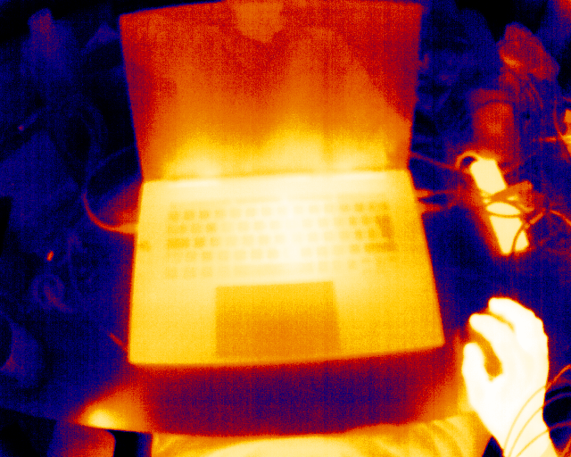
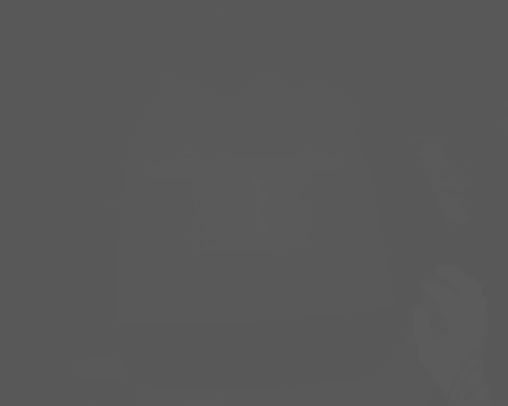
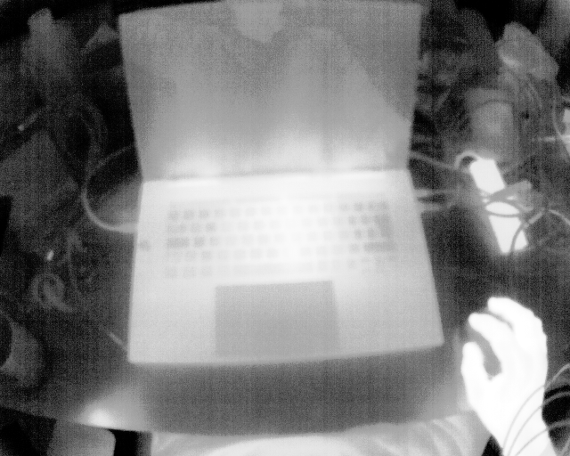

# FLIR ADK 75 Driver

Portable C driver for the FLIR ADK 75° thermal camera (Boson 640 core). V4L2 capture + CCI serial control via FSLP protocol. Zero external dependencies, cross-compiles to ARM, MIPS, x86.



## Features

**V4L2 MMAP capture** -- 640x512 LWIR frames at 60fps in AGC 8-bit (YU12) or RAW 16-bit (Y16) mode.

**CCI serial control** -- FSLP protocol implementation (921600 baud, byte-stuffed framing, CRC-16/AUG-CCITT). Verified against Boson+ SDK IDD Rev410.

**Histogram-equalization AGC** -- CDF-based 14-bit to 8-bit tone mapping with 0.5% dead/hot pixel rejection. Better contrast than linear stretch.

**Iron-bow colorizer** -- Compile-time 256-entry RGB LUT. Zero runtime allocation.

**Software spot meter** -- ROI statistics (mean, std, min/max with pixel location) computed from RAW16 frames. Works on any camera variant including non-radiometric units.

**CCI capability probe** -- Discovers which camera modules are available (radiometry, spot meter, TLinear, AGC, etc.) at runtime.

**Cross-compilation** -- Builds with any C11 toolchain. Tested targets: x86_64, aarch64 (Jetson Orin, NXP i.MX8), MIPS (OpenWrt/QCA9533). Platform accelerator interface for GPU-accelerated processing.

## Sample Output

| RAW16 (14-bit) | HEQ Grayscale | Iron-bow False Color |
|:-:|:-:|:-:|
|  |  |  |

CCI probe output on a non-radiometric unit (20640A075-6PADK):
```
Core:
  bosonGetCameraSN                    OK [4] 00 05 d7 80
  bosonGetSensorSN                    OK [4] 00 3b 6c d0
  bosonGetCameraPN                    OK [20] 32 30 36 34 ...
  bosonFPATempDegCx10                 OK [2] 01 76
  bosonGetGainMode                    OK [4] 00 00 00 00

Radiometry:
  radiometryGetTempStableEnable       NOT AVAILABLE

Spot Meter:
  spotMeterGetEnable                  NOT AVAILABLE

Telemetry:
  telemetryGetState                   OK [4] 00 00 00 01
```

Calibration run with software spot meter:
```
Camera S/N: 382848  |  Sensor S/N: 3894480  |  P/N: 20640A075-6PADK
FPA temperature: 37.5 C

Frame 4: range=[22490-23527] mean=22758.0 std=186.03
  spot(center): mean=23082 std=109.2 range=[22831-23401] cold@(275,418) hot@(242,325)

Average temporal noise: 4.23 counts
```

## Build

```sh
make                                # x86_64
make CC=aarch64-linux-gnu-gcc       # ARM64 (Jetson, i.MX8)
make CC=mips-openwrt-linux-gcc      # MIPS (QCA9533)
```

Produces: `libflir_adk.a`, `flir_grab`, `flir_calibrate`, `cci_probe`.

Dependencies: libc, libm, Linux kernel headers (V4L2, termios). Nothing else.

## Usage

```sh
# Probe camera CCI capabilities
./cci_probe -d /dev/video5 -c /dev/ttyACM0

# Capture RAW16 frames to stdout
./flir_grab -d /dev/video5 -c /dev/ttyACM0 -m raw16 -n 10 > frames.raw

# Full calibration: CCI report + HEQ AGC + spot meter + iron-bow output
./flir_calibrate -d /dev/video5 -c /dev/ttyACM0 -n 10 -o output

# Python test with PNG output (requires Pillow + ffmpeg)
python3 tools/flir_test.py -d /dev/video5 -c /dev/ttyACM0 -n 5 -o output
```

## Architecture

```
include/flir_adk.h          Public API (opaque handle, enums, frame struct)
src/capture.c               V4L2 MMAP streaming
src/cci.c                   FSLP protocol + CCI command wrappers
src/spotmeter.c             Software spot meter (ROI stats from RAW16)
platform/accel_generic.c    HEQ AGC + iron-bow colorizer (pure C)
platform/accel_cuda.c       Jetson Orin stub (GPU-accelerated AGC)
platform/accel_imx8.c       NXP i.MX8 stub (VPU + GPU)
tools/                      CLI tools and Python test script
```

The `struct flir_accel` interface allows platform-specific accelerated implementations for AGC and colorization while keeping the core driver portable.

## Camera Variants

| Variant | Part Suffix | Radiometry | HW Spot Meter | TLinear |
|---------|-------------|:----------:|:-------------:|:-------:|
| Standard | 6**P** | -- | -- | -- |
| Radiometric | 6**R** | yes | yes | yes |

Non-radiometric units return status `0x0161` for radiometry/spotmeter/TLinear/AGC CCI modules. The driver detects this at runtime and falls back to software implementations.

## License

Proprietary. Camera protocol details from Boson+ SDK IDD Rev410 (Teledyne FLIR).
