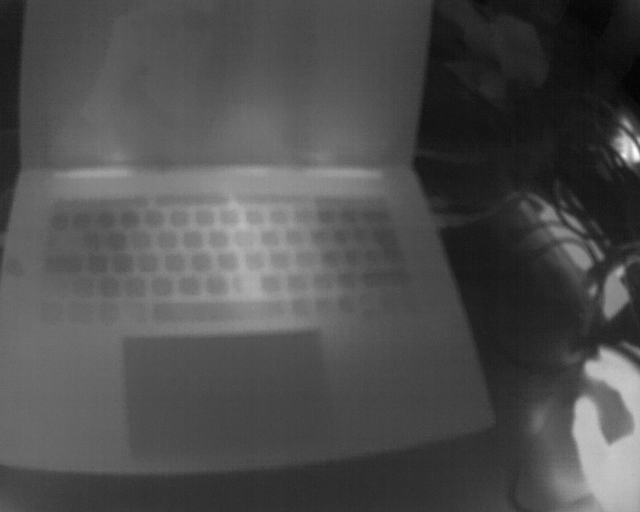
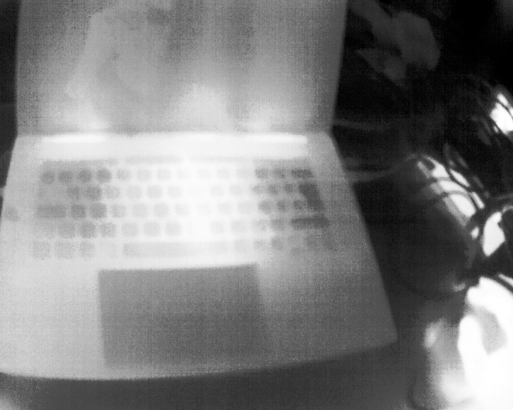
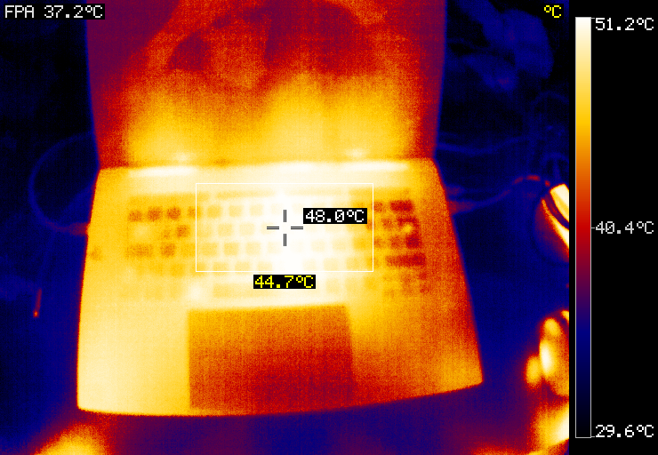
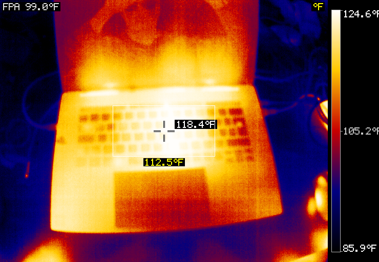
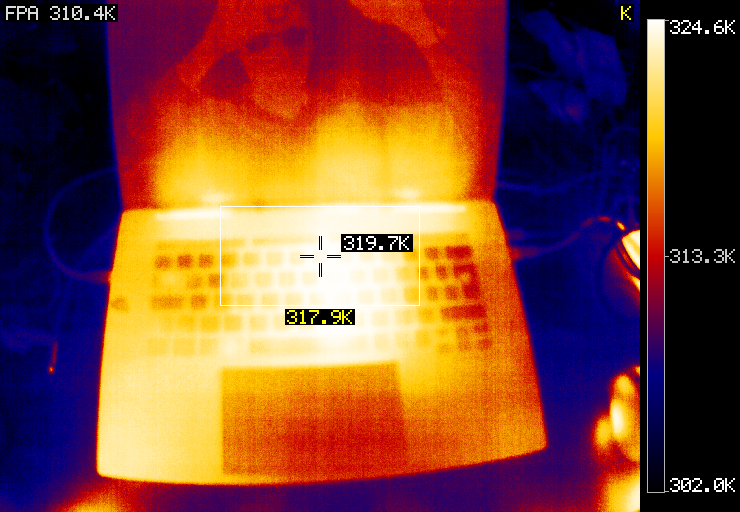

# FLIR ADK 75 Driver

Portable C driver for the FLIR ADK 75° thermal camera (Boson 640 core). V4L2 capture + CCI serial control via FSLP protocol. Zero external dependencies, cross-compiles to ARM, MIPS, x86.


## Features

**V4L2 MMAP capture** -- 640x512 LWIR frames at 60 or 30 fps in AGC 8-bit (YU12), NV12 or RAW 16-bit (Y16) mode.

**CCI serial control** -- FSLP protocol implementation (921600 baud, byte-stuffed framing, CRC-16/AUG-CCITT). Command IDs from Boson Software IDD 102-2013-44, plus Boson+ IDD Rev410 for radiometric commands.

**Camera controls** -- FFC mode / thresholds / status, on-camera noise filters (TF, SCNR, SPNR, BPR), camera AGC parameters for the 8-bit stream (gamma, linear percent, max gain, ROI ...), freeze, e-zoom with centre, DVO, image statistics, splash duration, symbology overlay, read-only fileOps. All scalar settings live in one table (`flir_params[]`).

**Status & persistence** -- `flir_ctl status` prints every readable value as one JSON object. `save`, `factory-reset`, `reboot` require `--confirm` (web/OBS/VLC ask first).

**Histogram-equalization AGC** -- CDF-based 14-bit to 8-bit tone mapping with 0.5% dead/hot pixel rejection. Better contrast than linear stretch.

**Iron-bow colorizer** -- Compile-time 256-entry RGB LUT. Zero runtime allocation.

**Software spot meter** -- ROI statistics (mean, std, min/max with pixel location) computed from RAW16 frames. Works on any camera variant including non-radiometric units.

**Thermal OSD overlay** -- Professional camera-style display with center crosshair + temperature reading, spot meter ROI box, FPA temperature, and iron-bow color bar with scale. Selectable temperature units (°C, °F, K) via linear calibration from FPA reference.

**CCI capability probe** -- Discovers which camera modules are available (radiometry, spot meter, TLinear, AGC, etc.) at runtime.

**Cross-compilation** -- Builds with any C11 toolchain. Tested targets: x86_64, aarch64 (Jetson Orin, NXP i.MX8), MIPS (OpenWrt/QCA9533). Platform accelerator interface for GPU-accelerated processing.

## Sample Output

| RAW16 (14-bit) | HEQ Grayscale | Iron-bow + OSD |
|:-:|:-:|:-:|
|  |  |  |

### Temperature Units

| Celsius | Fahrenheit | Kelvin |
|:-:|:-:|:-:|
|  |  |  |

CCI probe output on a non-radiometric unit (20640A075-6PADK):
```
Core:
  bosonGetCameraSN                    OK [4] 00 05 d7 80
  bosonGetSensorSN                    OK [4] 00 3b 6c d0
  bosonGetCameraPN                    OK [20] 32 30 36 34 ...
  bosonFPATempDegCx10                 OK [2] 01 76
  bosonGetGainMode                    OK [4] 00 00 00 00

Radiometry:
  radiometryGetTempStableEnable       NOT AVAILABLE

Spot Meter:
  spotMeterGetEnable                  NOT AVAILABLE

Telemetry:
  telemetryGetState                   OK [4] 00 00 00 01
```

Calibration run with software spot meter:
```
Camera S/N: 382848  |  Sensor S/N: 3894480  |  P/N: 20640A075-6PADK
FPA temperature: 37.5 C

Frame 4: range=[22490-23527] mean=22758.0 std=186.03
  spot(center): mean=23082 std=109.2 range=[22831-23401] cold@(275,418) hot@(242,325)

Average temporal noise: 4.23 counts
```

## Build

```sh
make                                # x86_64
make CC=aarch64-linux-gnu-gcc       # ARM64 (Jetson, i.MX8)
make CC=mips-openwrt-linux-gcc      # MIPS (QCA9533)
make test                           # unit tests, no camera needed
```

Produces: `libflir_adk.a`, `flir_grab`, `flir_calibrate`, `cci_probe`, `flir_ctl`, `flir_loop`.

Dependencies: libc, libm, Linux kernel headers (V4L2, termios). Nothing else.

## Usage

```sh
# Probe camera CCI capabilities
./cci_probe -d /dev/video5 -c /dev/ttyACM0

# Capture RAW16 frames to stdout
./flir_grab -d /dev/video5 -c /dev/ttyACM0 -m raw16 -n 10 > frames.raw

# Full calibration: CCI report + HEQ AGC + spot meter + iron-bow output
./flir_calibrate -d /dev/video5 -c /dev/ttyACM0 -n 10 -o output

# Same with temperature display in Fahrenheit (also accepts C or K)
./flir_calibrate -d /dev/video5 -c /dev/ttyACM0 -n 10 -o output -u F

# Python test with PNG output (requires Pillow + ffmpeg)
python3 tools/flir_test.py -d /dev/video5 -c /dev/ttyACM0 -n 5 -o output
```

```sh
# Camera control (one JSON line per call; works while another process streams)
./flir_ctl status
./flir_ctl ffc-mode 1            # 0 manual, 1 auto, 2 external
./flir_ctl agc-gamma 0.9         # camera AGC (8-bit stream)
./flir_ctl tf 0                  # camera temporal filter off
./flir_ctl save --confirm        # write settings to camera flash

# NV12 at 30 fps
./flir_grab -d /dev/video5 -m nv12 -r 30 -n 10 > frames.nv12
```

## Architecture

```
include/flir_adk.h          Public API (opaque handle, enums, frame struct)
src/capture.c               V4L2 MMAP streaming
src/cci.c                   FSLP protocol + CCI command wrappers
src/spotmeter.c             Software spot meter (ROI stats from RAW16)
src/colorbar.c              Thermal OSD overlay (color bar, crosshair, temp units)
src/cci_params.c            Scalar settings table (flir_params[])
src/cci_system.c            FW rev, persistence, ROIs, splash, read-only fileOps
src/cci_symbology.c         On-camera symbology
platform/accel_generic.c    HEQ AGC + iron-bow colorizer (pure C)
platform/accel_cuda.c       Jetson Orin stub (GPU-accelerated AGC)
platform/accel_imx8.c       NXP i.MX8 stub (VPU + GPU)
tools/flir_ctl.c            One CCI command -> one JSON line
tools/flir_web.py           Web control panel
tools/flir_loop.c           RAW16 -> v4l2loopback (VLC/OBS)
tools/                      CLI tools and Python test script
```

The `struct flir_accel` interface allows platform-specific accelerated implementations for AGC and colorization while keeping the core driver portable.

## Camera Variants

| Variant | Part Suffix | Radiometry | HW Spot Meter | TLinear |
|---------|-------------|:----------:|:-------------:|:-------:|
| Standard | 6**P** | -- | -- | -- |
| Radiometric | 6**R** | yes | yes | yes |

Non-radiometric units return status `0x0161` for radiometry / spot meter / TLinear and for the Boson+-only agcSetMode. Camera AGC parameters, noise filters, scaler, FFC and symbology work on all variants. The driver falls back to software spot meter and HEQ AGC for RAW16.

## License

GPLv2. See [LICENSE](LICENSE).

CCI command IDs and FSLP frame layout derived from the Boson+ SDK IDD Rev410 (Teledyne FLIR). All code is an original implementation.
